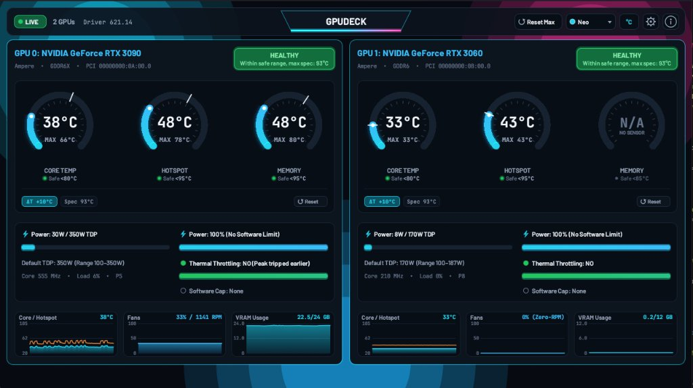

# GPUDeck

> **Warning**: This is a vibe coded app, may have important bugs, don't use it for any mission critical purpose. Use at your own risk.

> The healthy indicators for temps are somewhat arbitrary, based on rule of thumb, they should be used as a rough guide only. Check your GPU manufacturer's website for more accurate information. Some models may report different temperatures for the same conditions.

A cross-platform (Windows & Linux) multi-GPU thermal, power limit, and throttling dashboard built in Rust with `eframe`/`egui`.



## Features

- **Multi-GPU Live Grid**: Displays all detected GPUs simultaneously without switching tabs or clicking.
- **Core, Hotspot & Memory Junction Temperatures**:
  - Uses NVIDIA NVML (`nvml-wrapper`) on Windows & Linux.
  - On Windows, dynamically queries `nvapi64.dll` extended thermal sensors (`0x65FE3AAD`) for **GPU Hotspot** and **VRAM Memory Junction** temperatures (with NVML field queries on Linux where exposed by the driver).
  - Supports **AMD** and **Intel** GPUs on Linux via `/sys/class/drm/card*/device/hwmon`.
- **Healthy Temperature Guidelines**: Per-GPU temperature thresholds (`Healthy`, `Warm`, `Critical`) tailored by driver-reported thresholds and VRAM type (`GDDR5`, `GDDR5X`, `GDDR6`, `GDDR6X`, `GDDR7`, `HBM2`), plus Hotspot − Core delta ($\Delta T$) monitoring.
- **Persistent Max Temperature Records**: Tracks recorded peak Core, Hotspot, and Memory temperatures across sessions with a high-watermark tick and `MAX` readout on every gauge, plus per-GPU and global **Reset** buttons (`records.cfg`).
- **Power Limit & Software Cap Detection**:
  - Compares enforced power ceiling against factory default TDP to show `100% (No Software Limit)`, `SW Limit (<99%)`, or `Unlocked (>101%)`.
  - Reads active NVML/sysfs throttle reasons (`SW Power Cap`, `HW Thermal Slowdown`, `SW Thermal Slowdown`, `HW Power Brake`, `App Clocks Cap`).
- **Live Telemetry Sparklines (2 Conceptual Rows)**:
  - **Thermals & Cooling**: Core/Hotspot temperatures, Memory temperature, and Fan % & RPM (including Zero-RPM detection).
  - **Workload & Power**: GPU utilization (%), VRAM usage (GB), and Power draw (W).
- **9 Built-In Themes (Persisted Automatically)**:
  - `neo` (Neo — default dark neon cockpit)
  - `frutiger-aero` (Frutiger Aero — sky bubbles & glossy glass)
  - `kawaii` (Kawaii — sakura & lavender pastel bubbles)
  - `japandi` (Japandi — warm linen, matcha sage & terracotta)
  - `minimalist` (Minimalist — crisp Swiss precision)
  - `modern` (Modern — sleek dark carbon & indigo)
  - `win-like` (Win-Like — Windows 11 Dark Mica & Fluent accent)
  - `terminal` (Terminal — phosphor green CRT & monospace blocks)
  - `corporate` (Corporate — executive navy header & enterprise slate)

## Usage

```bash
# Run the GUI (live hardware telemetry)
cargo run --release

# Launch directly with a specific theme
cargo run --release -- --theme frutiger-aero

# Print detected GPU telemetry once to stdout and exit
cargo run -- --probe

# Customize polling interval (ms)
cargo run -- --interval 500
```

## Requirements

- **Rust toolchain** (1.85+ / stable)
- **Windows**: NVIDIA display driver (installs `nvml.dll` and `nvapi64.dll` automatically).
- **Linux**:
  - NVIDIA proprietary driver (`libnvidia-ml.so.1`) for NVIDIA GPUs, or kernel `amdgpu`/`i915`/`xe` `hwmon` sysfs for AMD/Intel GPUs.
  - Standard desktop OpenGL / windowing development libraries required by `eframe`/`glutin` (e.g., on Debian/Ubuntu: `libxcb-render0-dev libxcb-shape0-dev libxcb-xfixes0-dev libxkbcommon-dev libssl-dev libgl1-mesa-dev`).

## Creating a Release

Releases are automated via GitHub Actions ([`.github/workflows/release.yml`](.github/workflows/release.yml)) using SemVer tags (`vX.Y.Z`):

1. Update `version` in `Cargo.toml` (for example `0.1.0`), run `cargo test` so `Cargo.lock` updates to match, and commit your changes.
2. Create and push a matching version tag:
   ```bash
   git tag v0.1.0
   git push origin main --tags
   ```
   Pre-release tags containing a hyphen suffix (e.g., `v0.2.0-beta.1`) automatically publish as GitHub Pre-releases.
3. The Release workflow verifies that the git tag matches `Cargo.toml`, builds Windows (`x86_64-pc-windows-msvc` `.zip`) and Linux (`x86_64-unknown-linux-gnu` `.tar.gz`) archives plus `SHA256SUMS.txt`, and creates the GitHub Release with generated release notes.

## Disclaimer & Limitation of Liability

GPUDeck is provided **"AS IS"**, without warranty of any kind, express or implied (including, without limitation, warranties of merchantability, fitness for a particular purpose, accuracy, or non-infringement), strictly for **informational hardware monitoring only**.

- GPU telemetry values are obtained from third-party graphics drivers, operating system interfaces, and undocumented vendor APIs (such as Windows `nvapi64.dll`), and may be delayed, unavailable, incomplete, or inaccurate depending on GPU model, driver version, or sensor hardware.
- Displayed "Healthy", "Warm", and "Critical" temperature thresholds are general rule-of-thumb guidelines and **not** official manufacturer safety specifications or hardware protection guarantees.
- **No Responsibility for Hardware Damage:** To the maximum extent permitted by applicable law, the author (**Javier Garcia**) and contributors shall **not** be held responsible or liable for any direct, indirect, incidental, special, exemplary, or consequential damages — including, without limitation, **overheated, throttled, degraded, or burned/damaged GPUs or other hardware components, cooling/shutdown failures, system crashes, or loss of data** — arising from the use of, reliance on, or inability to use this software. You use this software entirely at your own risk and remain solely responsible for verifying hardware temperatures with manufacturer tools and maintaining adequate system cooling.

## License & Third-Party Notices

Copyright (c) 2026 Javier Garcia

- **Application Source Code:** Licensed under the **Mozilla Public License Version 2.0 (MPL-2.0)** — see [LICENSE](LICENSE).
- **Bundled Font Software (`assets/fonts/`):** **Barlow** and **JetBrains Mono** remain licensed under the **SIL Open Font License, Version 1.1** — see [assets/fonts/OFL.txt](assets/fonts/OFL.txt).
- **Third-Party Libraries & External Code Citations:** Full attributions for all Rust dependencies (`eframe`, `egui`, `nvml-wrapper`, `serde`, `libloading`, transitive crates) and referenced reverse-engineered NVAPI definitions from **LibreHardwareMonitor** (`MPL-2.0`) are documented in [THIRD_PARTY_NOTICES.md](THIRD_PARTY_NOTICES.md).
